<div align="center">


# Charge Monitor

**An Android app that logs every charge in the background and tells you what each power bank and charger really delivers.**

[](https://github.com/AbdelRahman-Madboly/charge-monitor/actions/workflows/ci.yml)


[How it works](#how-it-works) · [Screenshots](#screenshots) · [Hardware](#hardware) · [Quick start](#quick-start) · [What it does not do](#what-it-does-not-do)

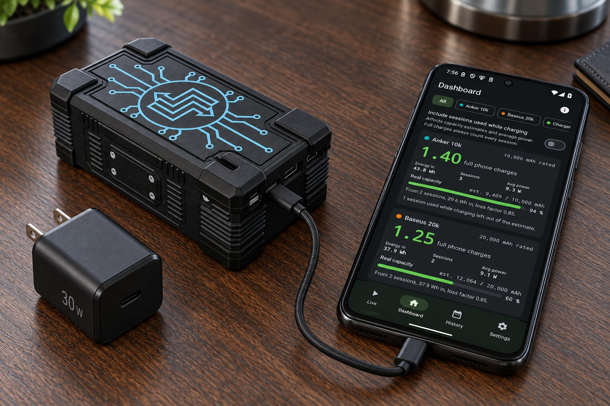

<sub>Concept image of the app measuring the PB-3 power bank, not a photo. The phone screen is the emulator screenshot with mock data, not a measured result.</sub>

</div>

## Why Charge Monitor

A power bank label says how many mAh the cells hold, not how many times it will charge your
phone. Charge Monitor records every charge of the phone in the background, per power source, so
you can see how many full phone charges each power bank really gives, its usable capacity against
the label, and what current, voltage and wattage each charger delivers.

Installed as **Bank Tester**. The package id stays `com.vinex.chargemonitor`, so an update keeps
every recorded session. The design and its reasoning are in
[`docs/specs/2026-09-28-charge-monitor-design.md`](docs/specs/2026-09-28-charge-monitor-design.md).

## Highlights

- **Logs in the background.** A foreground service records every charge per power source,
  restarts itself on boot and after updates, and needs no tap to start a session.
- **Full charges per bank.** Partial charges add up: 15 to 80 % plus 5 to 35 % is 0.95 of a
  full charge.
- **Real capacity against the label.** Mark *Recharged* and *Ran empty* on a bank's card and
  the app works out the energy it delivered, compared in Wh, not mAh.
- **Charger cards.** Peak power into the battery against the charger's rating, average power and
  charging speed in %/h.
- **Laptops kept apart.** A laptop is recognised by the USB data connection and never counts
  toward a power bank.
- **Offline by design.** No internet permission. Data leaves the phone only through CSV export.

## How it works

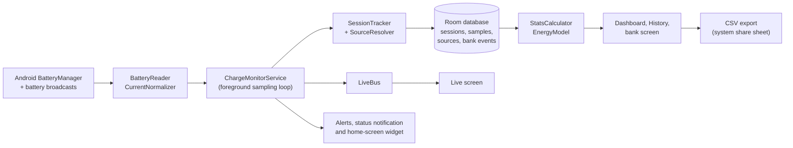

The service reads the battery every settings interval (2 s while the Live screen is visible).
In mock mode `MockBatterySource` takes the place of the real reader.

## Screenshots

| Live | Dashboard | Charts | History |
|---|---|---|---|
| 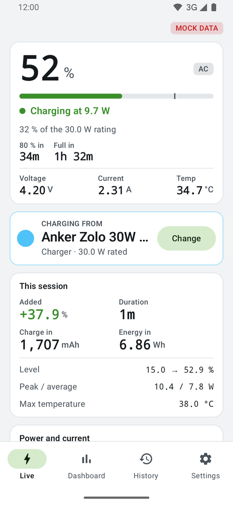 | 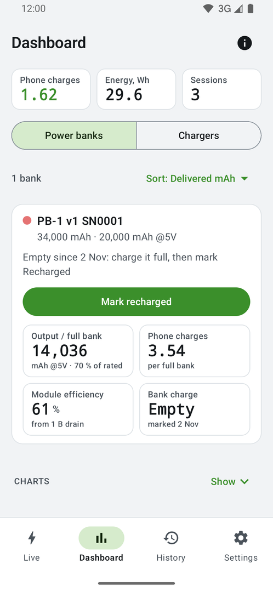 | 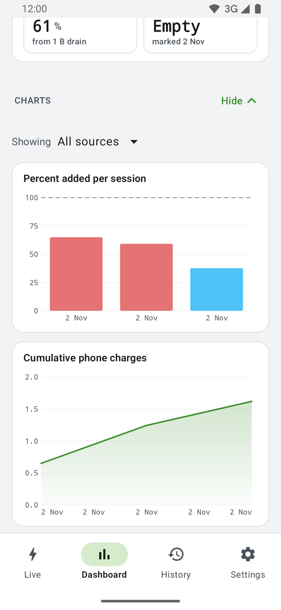 | 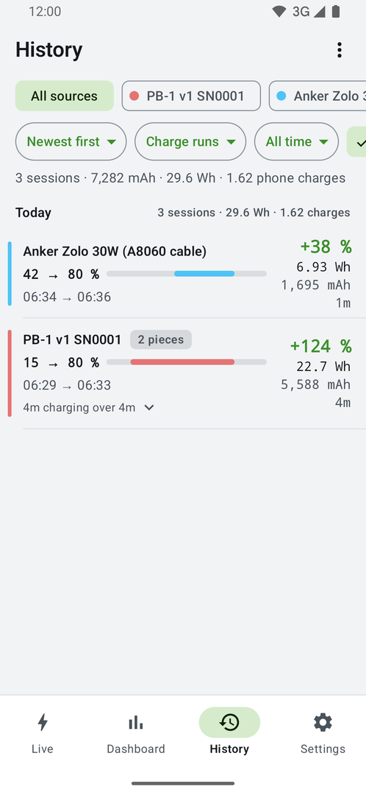 |

| Session detail | Charging from | Bank test guide | Bank product sheet |
|---|---|---|---|
| 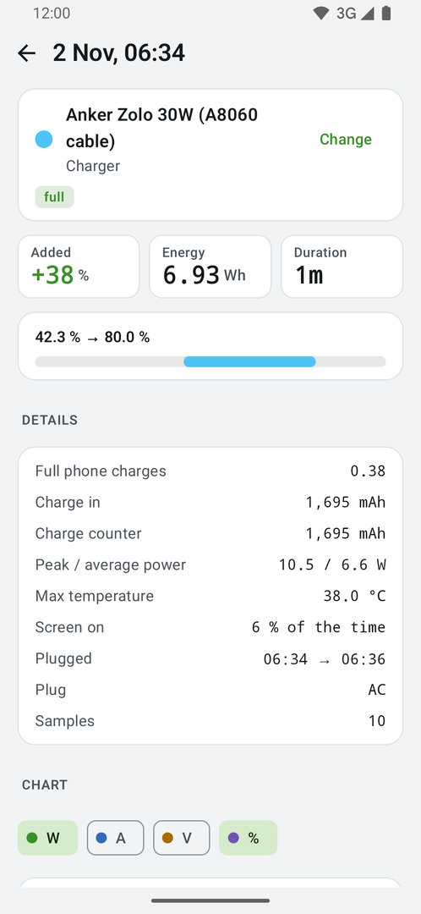 | 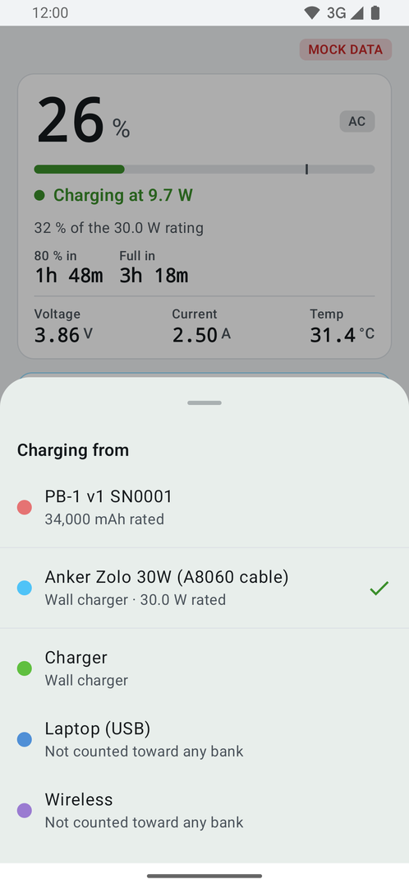 | 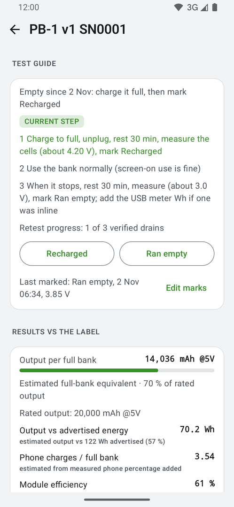 | 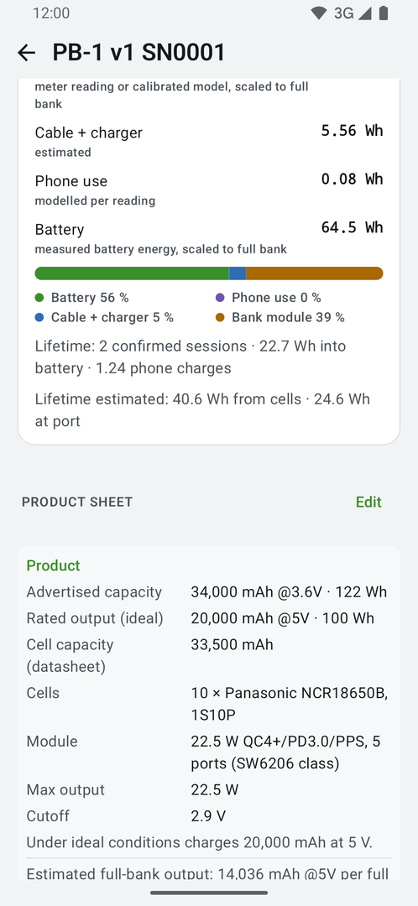 |

| Settings | Setup |
|---|---|
| 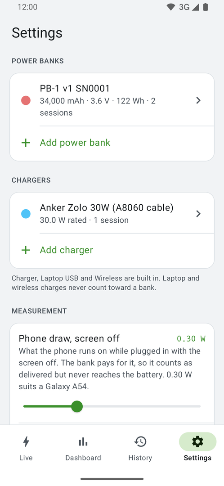 | 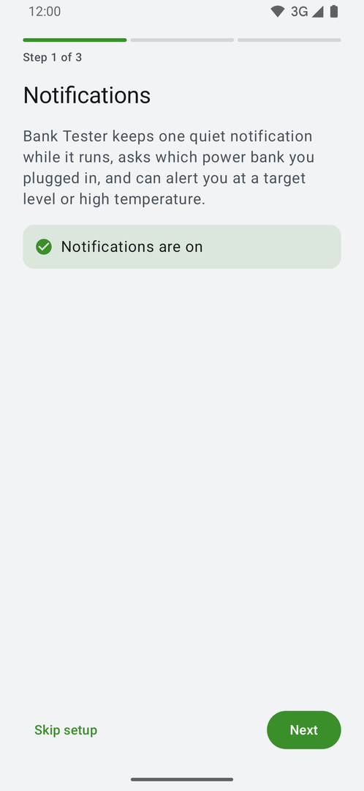 |

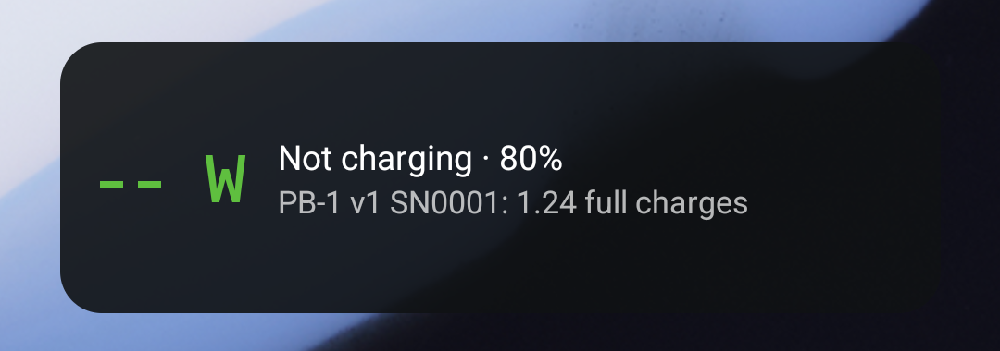

<sub>Emulator with mock data: the sessions and the PB-1 bank results are synthetic, not measurements.</sub>

## Hardware

The app was built to test PB-3, a home-built 10 x 18650 power bank in a 3D-printed case. Its STL
files, print materials and a render are in [`hardware/pb3-power-bank`](hardware/pb3-power-bank).

| Design | Charging a phone (concept image) |
|---|---|
| 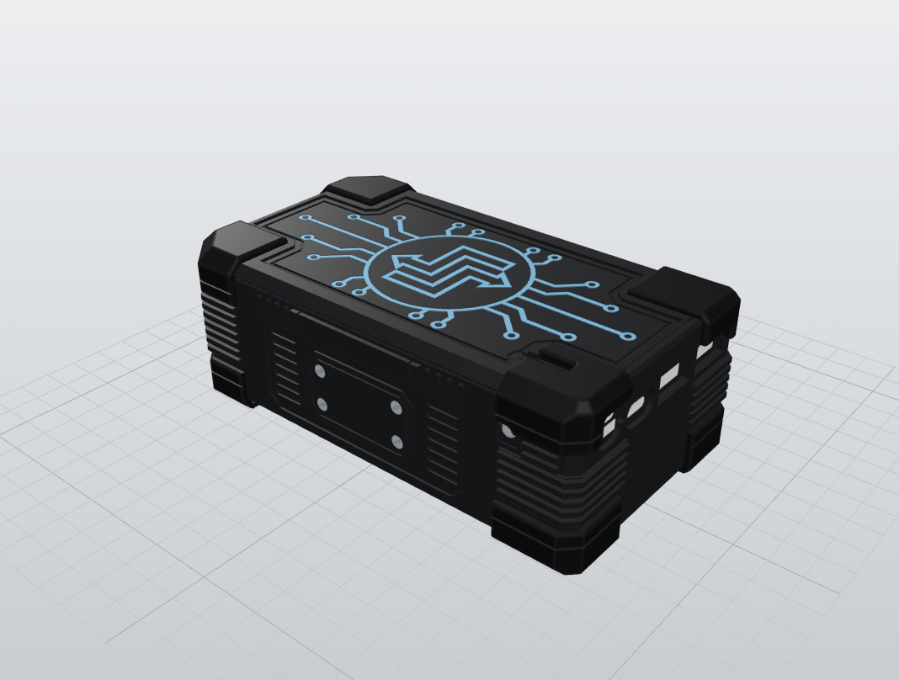 | 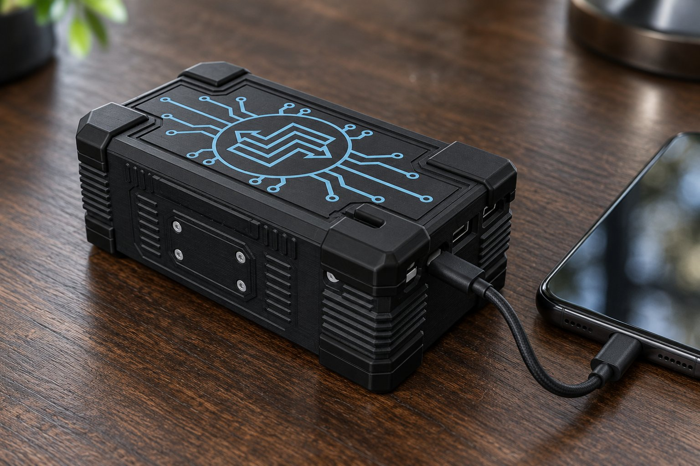 |

The right-hand picture is a concept image, not a photo.

## How it measures

- **Full charges** per power bank are the sum of % added across its sessions, divided by 100.
  Partial charges add up: 15 to 80 % plus 5 to 35 % is 0.95.
- **Charge and energy** come from the fuel gauge's charge counter once it has moved 30 mAh, and
  from integrating current for shorter sessions.
- **Delivered to phone** adds what the phone used while charging to what the battery gained, so
  a bank used with the screen on is not penalised. The phone's draw is the median charge current
  with the screen off minus the median with it on (below 80 %), counted over screen-on time; a
  session with no screen-off baseline uses the phone's typical measured draw. Screen-off idle
  use is not counted, so the figure is a lower bound. Banks rank by it by default.
- **Real bank capacity** is the energy delivered between tapping *Recharged* and *Ran empty* on
  the bank's card, divided by a conversion-loss factor (0.85 by default).
- **Laptops** are recognised by the USB data connection and never count toward a power bank. A
  laptop port that fast-charges reports as AC, so plug type alone cannot tell.
- **Phone charges per full bank** is the median, over marked drains, of the % added between a
  *Recharged* and the next *Ran empty*. Before the first drain the card shows what the label
  promises instead: rated Wh × loss factor ÷ the phone battery's Wh.
- **Chargers** can be added by name with their rated watts. A charger card shows peak power into
  the battery against that rating, average power, and charging speed in %/h. It is all measured
  at the battery, so a 30 W charger on a phone that accepts 25 W never reads 30.
- **Comparing banks** uses Wh, not mAh. A mAh label only compares with another rated at the
  same cell voltage.
- **Mains or power bank?** The phone cannot tell, so plugging into AC raises a notification that
  asks. Unconfirmed sessions stay out of bank totals.

## Quick start

Needs JDK 17 and the Android SDK (platform 34). Put the SDK path in `local.properties`
(`sdk.dir=/path/to/Android/Sdk`, not committed).

```bash
git clone https://github.com/AbdelRahman-Madboly/charge-monitor.git && cd charge-monitor
./gradlew assembleDebug testDebugUnitTest
```

The APK lands in `app/build/outputs/apk/debug/app-debug.apk`.

On Samsung phones with a Secure Folder or work profile, install for the main user only:

```bash
adb install --user 0 -r app/build/outputs/apk/debug/app-debug.apk
```

## Usage

1. Open the app once; that starts the monitoring service. After that it restarts itself on boot
   and after updates.
2. For reliable background logging, allow notifications and exempt the app from battery
   optimisation (on Samsung also add it to "Never sleeping apps").
3. Plug in. When the phone reports AC, answer the notification to say whether it is mains or a
   power bank.
4. On a bank's card, tap *Recharged* after filling the bank and *Ran empty* when it is drained,
   so the app can measure its real capacity.

**Preset sources.** A new install, and the first launch after an upgrade, adds the sources listed
in `SourcePresets` once: a home-built 1S10P NCR18650B bank and a 30 W USB-C wall charger. Edit
that file to ship your own. A preset whose name is already taken is skipped, and existing rows
are never changed. The Appearance setting picks System, Light or Dark.

### Mock mode

For working on the UI without a charger, a synthetic source replays a 15 to 80 % charge in about
a minute, then unplugs for 15 s, and repeats:

```bash
adb shell setprop debug.chargemonitor.mock 1   # on
adb shell setprop debug.chargemonitor.mock 0   # off
```

Debug builds also have a mock toggle in Settings, for devices where the property cannot be read.

## What it does not do

- It does not measure the power bank directly. Every figure is read at the phone's battery, so
  the bank's own losses are estimated from marked drains and a conversion-loss factor.
- It cannot tell mains from a power bank on its own; an AC session needs a tap to confirm.
- It does not sync, upload or back up anything. There is no internet permission; data leaves
  the phone only through CSV export.
- It is not on Google Play. It is built from source and installed with `adb`.

## Permissions

Five, all explainable: notifications, foreground service (plus its special-use type), boot
completed, and the battery-optimisation exemption request. No internet access; CSV export goes
through the system share sheet.

## Status

v1.0.0 plus the unreleased changes in [CHANGELOG.md](CHANGELOG.md). Built as a personal tool and
used daily on one Samsung phone (Android 16).

| Part | State |
|---|---|
| Live, Dashboard, History, bank screen, Settings | Work end to end |
| Home-screen widget, CSV export, Samsung's fast-charge flag | Not yet checked on a device |
| Other phones | They report charge current in different units and signs; `CurrentNormalizer` handles the common cases, but a phone it has not seen may need a setting |

## Tests

Each command is what CI runs (`.github/workflows/ci.yml`).

| Component | Command | Result |
|---|---|---|
| App unit tests and debug build | `./gradlew test assembleDebug` | 246 JVM tests pass |
| Lint | `./gradlew lintDebug` | |
| Icon generator | `python tools/glyphgen/test_generate.py` | 12 tests pass |

## Launcher icon

The icon is the 18650 tester's, `tools/glyphgen/source_icon.png`, used as-is. The generator
renders it per density on a background of its own tile colour, sized so the battery stays inside
the 66 dp circle every launcher mask keeps. `appicon.txt` is a pixel trace of it, used only for
the themed (monochrome) icon. Never edit the generated files by hand:

```bash
uv run --no-project --with pillow python tools/glyphgen/generate.py
uv run --no-project --with pillow --with pytest python tools/glyphgen/test_generate.py
```

<details>
<summary><code>tools/glyphgen/preview.png</code> shows the result under the common mask shapes.</summary>


</details>

## Repository layout

| Folder | Contents |
|---|---|
| `app/` | The Android app (Kotlin, Jetpack Compose, Room) |
| `docs/` | Design spec, screenshots, README images |
| `hardware/pb3-power-bank/` | PB-3 power bank case: STLs, print materials and images |
| `tools/glyphgen/` | Launcher icon generator and its tests |

## License

MIT, see [LICENSE](LICENSE).

## Author

Designed and built by **Abdel Rahman Mohamad EL-Sayed** ([@AbdelRahman-Madboly](https://github.com/AbdelRahman-Madboly)).
