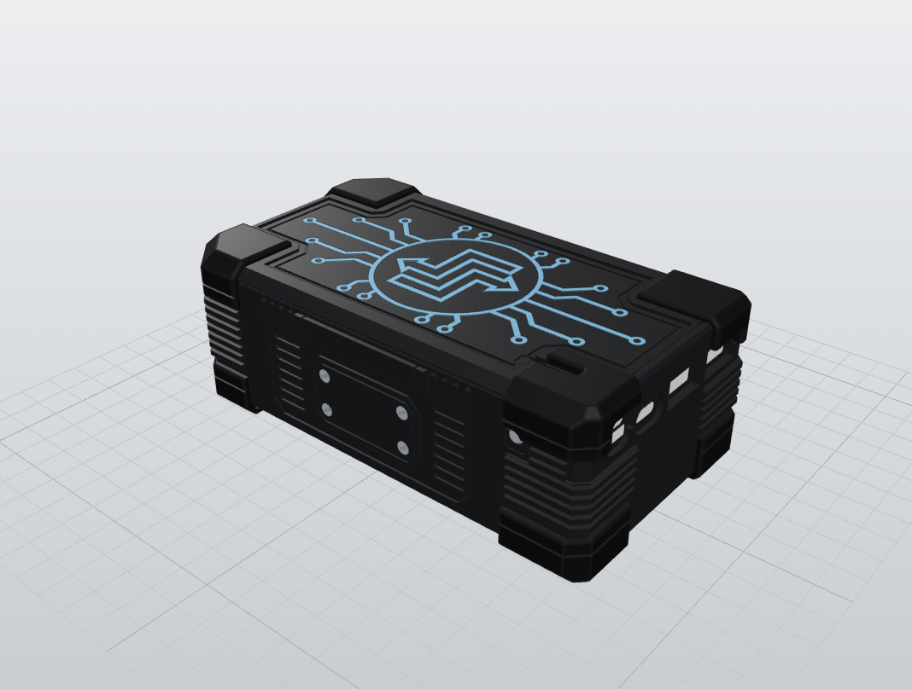
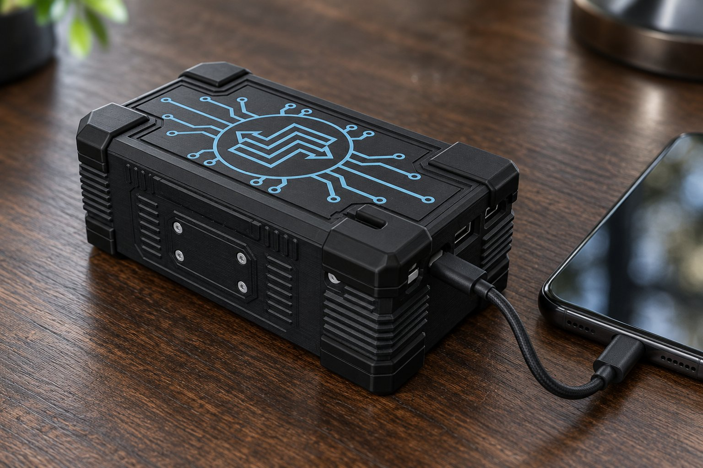

# PB-3 power bank case

The power bank this app was built to test. A home-built 1S10P pack of ten 18650 cells
(NCR18650B) on an SW6206 22.5 W charge board, in a 3D-printed rugged case. Charge Monitor ships
this pack as a preset source, so its real capacity and output can be measured from the phone
against the label.

| Design | Charging a phone |
|---|---|
|  |  |

The second picture is a concept image, not a photo of a built unit.

## Status

Design prototype, case B (version v036 of the assembly). Parts are sliced for a Bambu Lab A1 with
the AMS lite. Expect changes as the case is printed and tested.

| Item | Value |
|---|---|
| Body | 147.9 x 82 x 50 mm, about 152 x 86 x 54 mm over the corner caps |
| Cells | 10 x 18650 in a 2 x 5 holder, spot-welded |
| Board | SW6206, 22.5 W, all five sockets kept (micro-USB, Lightning, USB-C, 2 x USB-A) |
| Lid fixing | 2 x M3 x 12 countersunk screws into M3 nuts dropped in at a print pause |
| Board fixing | 4 x M1.6 x 5 self-tapping screws into 1.3 mm pilot holes |

## Printed parts

| File | Part | Material |
|---|---|---|
| `stl/box.stl` | Box with port frame and nut pockets | black PETG |
| `stl/lid.stl` | Top cover | black PETG |
| `stl/circuit.stl`, `stl/mark.stl` | Circuit pattern and logo inlay on the cover | light blue PLA+ (second colour) |
| `stl/back-text.stl` | Text on the back face | light grey PLA (second colour) |
| `stl/side-screws-l.stl`, `stl/side-screws-r.stl` | Decorative side screw heads | light grey PLA |
| `stl/button.stl` | Power button | light grey PLA |
| `stl/led-indicator.stl` | Light pipes over the board's five LEDs | translucent PETG |
| `stl/caps-top.stl`, `stl/caps-bottom.stl` | Corner caps | TPU 95A |

The two-colour parts share their geometry with the part they sit in, so load them together as one
object with two filaments.

## Use with the app

Add the bank in Charge Monitor (the preset is already there on a fresh install), charge the phone
from it, and mark *Recharged* and *Ran empty* on its card. The app then reports full phone charges
per bank and its usable capacity. Any other charger or power bank can be added the same way.
